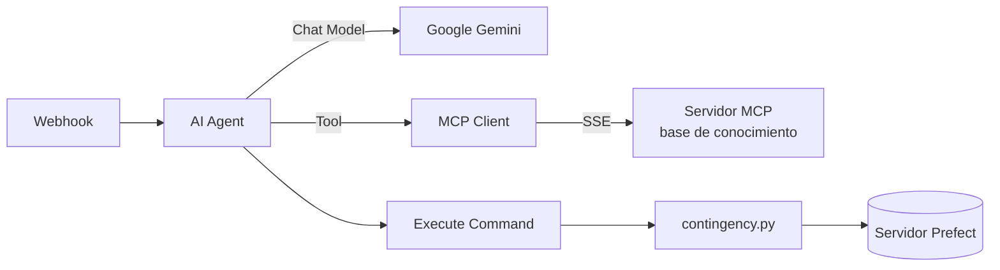
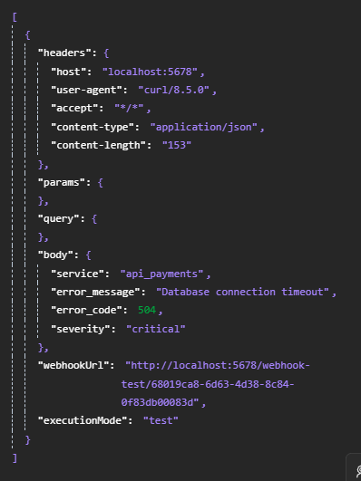
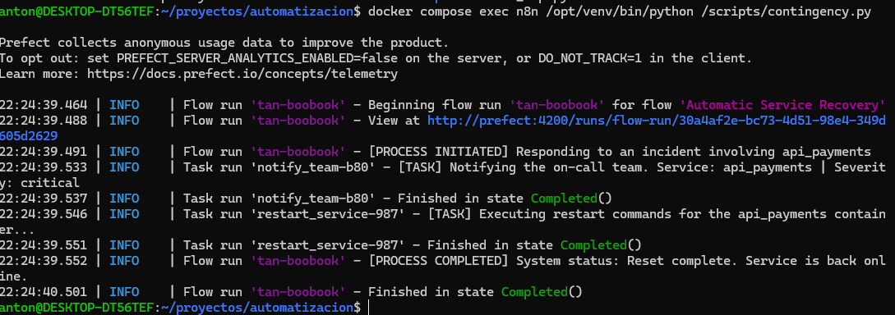
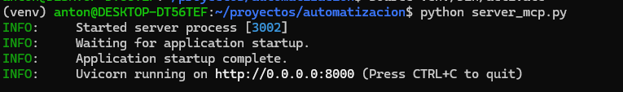
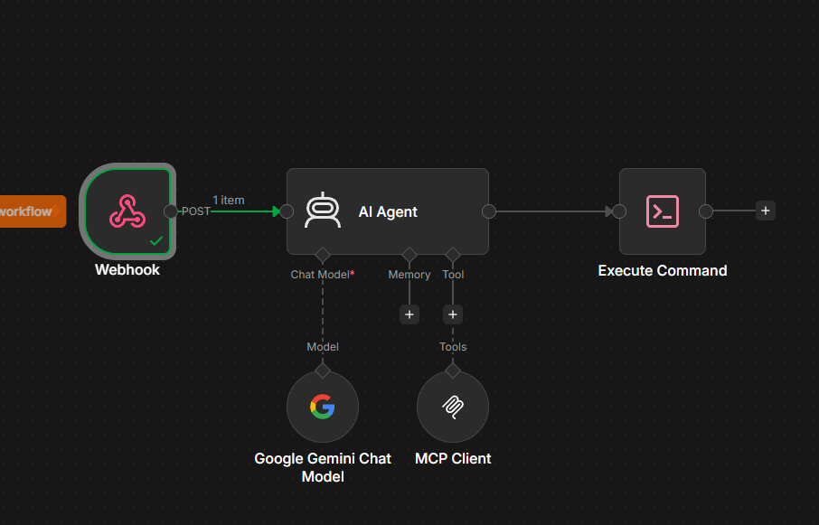
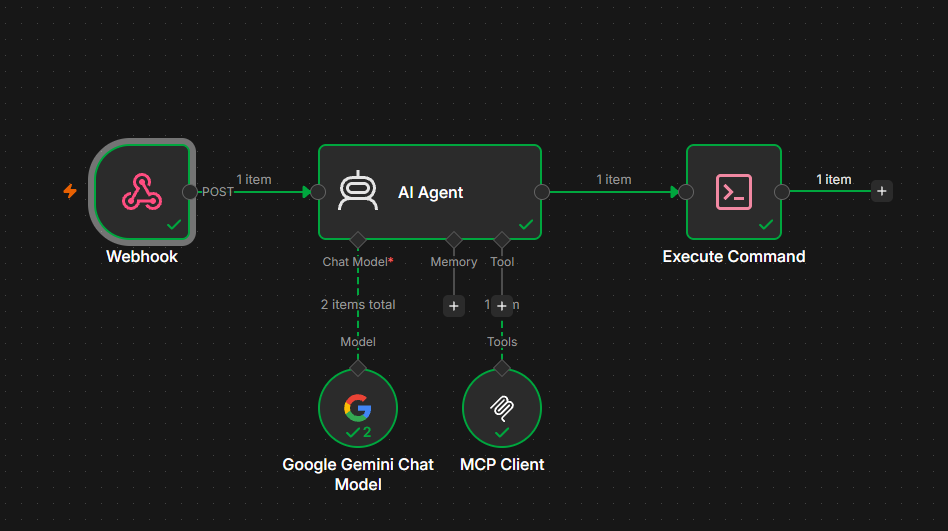
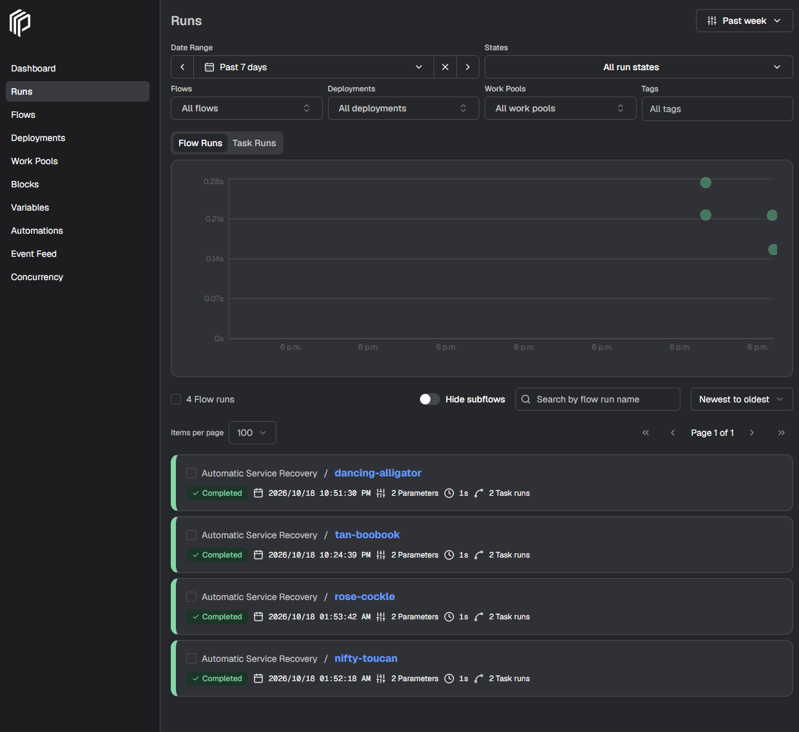

# llm-log-diagnostics-orchestrator

Orquestador de diagnóstico de fallas que combina **n8n**, un **agente de IA** (LLM), un **servidor MCP** con una base de conocimiento y **Prefect** como orquestador y monitor de flujos de trabajo.

Cuando un servicio reporta un error (por ejemplo, un timeout de base de datos con código `504`), n8n recibe el evento por un webhook, el agente consulta la base de conocimiento a través de MCP, determina la acción recomendada y se ejecuta un script de contingencia gestionado por Prefect.

---

## Tabla de contenidos

1. [Tecnologías](#tecnologías)
2. [Arquitectura](#arquitectura)
3. [Estructura del proyecto](#estructura-del-proyecto)
4. [Paso 1: Docker y Docker Compose](#paso-1-docker-y-docker-compose)
5. [Paso 2: Probar n8n con un Webhook](#paso-2-probar-n8n-con-un-webhook)
6. [Paso 3: Entorno virtual y script de contingencia](#paso-3-entorno-virtual-y-script-de-contingencia)
7. [Paso 4: Servidor MCP](#paso-4-servidor-mcp)
8. [Paso 5: Workflow en n8n](#paso-5-workflow-en-n8n)
9. [Paso 6: Ejecutar el workflow completo](#paso-6-ejecutar-el-workflow-completo)
10. [Notas de seguridad](#notas-de-seguridad)

---

## Tecnologías

| Tecnología | Uso en el proyecto |
|---|---|
| **Docker y Docker Compose** | Levantar todos los servicios de forma reproducible |
| **Python 3.10+** | Scripts de contingencia y servidor MCP |
| **n8n** (instancia local) | Automatización del flujo de trabajo |
| **LLM API key** (Gemini 3.5 Flash, aunque puede ser cualquier otro) | Modelo de lenguaje del agente |
| **Prefect** | Orquestador y monitor de flujos; manejo de errores |
| **Server-Sent Events (SSE)** | Envío de actualizaciones en tiempo real al cliente (el cliente MCP de n8n) |
| **PostgreSQL** | Base de datos de n8n |

---

## Arquitectura



---

## Estructura del proyecto

```text
automatizacion/
└── scripts/
    └── contingency.py
├── venv/
├── .env
├── .env.example
├── .gitignore
├── docker-compose.yml
├── Dockerfile
├── server_mcp.py
```

> **Importante:** `contingency.py` debe estar dentro de `scripts/`, porque el `docker-compose.yml` monta esa carpeta en el contenedor de n8n como `/scripts`.

---

## Paso 1: Docker y Docker Compose

### docker-compose.yml

Aquí se declaran los servicios necesarios: **postgres**, **n8n** y **prefect**.

```yaml
services:
  postgres:
    image: postgres:16
    restart: always
    environment:
      - POSTGRES_USER=${POSTGRES_USER}
      - POSTGRES_PASSWORD=${POSTGRES_PASSWORD}
      - POSTGRES_DB=${POSTGRES_DB}
    volumes:
      - db_storage:/var/lib/postgresql/data
    healthcheck:
      test: ['CMD-SHELL', 'pg_isready -h localhost -U ${POSTGRES_USER} -d ${POSTGRES_DB}']
      interval: 5s
      timeout: 5s
      retries: 10

  n8n:
    build: .
    restart: always
    environment:
      - DB_TYPE=postgresdb
      - DB_POSTGRESDB_HOST=postgres
      - DB_POSTGRESDB_PORT=5432
      - DB_POSTGRESDB_DATABASE=${POSTGRES_DB}
      - DB_POSTGRESDB_USER=${POSTGRES_USER}
      - DB_POSTGRESDB_PASSWORD=${POSTGRES_PASSWORD}
      - N8N_ENCRYPTION_KEY=${N8N_ENCRYPTION_KEY}
      - N8N_ENFORCE_SETTINGS_FILE_PERMISSIONS=false
      - NODES_EXCLUDE=[]
      - GENERIC_TIMEZONE=America/Mexico_City
      - TZ=America/Mexico_City
      - WEBHOOK_URL=http://localhost:5678/
      - PREFECT_API_URL=http://prefect:4200/api
    ports:
      - 5678:5678
    extra_hosts:
      - "host.docker.internal:host-gateway"
    volumes:
      - n8n_storage:/home/node/.n8n
      - ./scripts:/scripts
    depends_on:
      postgres:
        condition: service_healthy
      prefect:
        condition: service_healthy

  prefect:
    image: prefecthq/prefect:3-latest
    restart: always
    command: prefect server start --host 0.0.0.0
    ports:
      - 4200:4200
    volumes:
      - prefect_data:/root/.prefect
    healthcheck:
      test: ["CMD", "python", "-c", "import urllib.request; urllib.request.urlopen('http://localhost:4200/api/health')"]
      interval: 10s
      timeout: 5s
      retries: 10
      start_period: 30s

volumes:
  db_storage:
  n8n_storage:
  prefect_data:
```

Puntos clave:

- **Servidor Prefect propio.** Fue necesario para poder ver el manejo de errores a través del servidor y para que el nodo *Execute Command* de n8n ejecute el flow sin que Prefect tenga que levantar un servidor temporal en cada ejecución (que provocaba un *timeout*).
- **`NODES_EXCLUDE=[]`.** Desde la versión 2.0 de n8n, el nodo *Execute Command* viene deshabilitado por defecto por motivos de seguridad. Al tener una instancia autoalojada podemos habilitarlo con esta variable; sin ella el nodo no estaría disponible.
- **`condition: service_healthy`.** Es una buena práctica: n8n solo arranca cuando Postgres y Prefect ya están listos para recibir conexiones.

### Dockerfile

La imagen oficial de n8n es mínima y no incluye Python ni Prefect, por eso construimos una propia que instala las dependencias necesarias para que n8n pueda ejecutar scripts de Prefect.

```dockerfile
FROM node:24-alpine

RUN apk add --no-cache \
    python3 py3-pip \
    gcc musl-dev python3-dev \
    libffi-dev openssl-dev \
    su-exec tini tzdata

RUN python3 -m venv /opt/venv \
    && /opt/venv/bin/pip install --no-cache-dir --upgrade pip setuptools wheel \
    && /opt/venv/bin/pip install --no-cache-dir prefect

RUN npm install -g n8n@latest

RUN mkdir -p /home/node/.n8n /scripts \
    && chown -R node:node /home/node/.n8n /scripts

ENV PATH="/opt/venv/bin:$PATH"

USER node
WORKDIR /home/node
EXPOSE 5678

ENTRYPOINT ["tini", "--", "n8n"]
```

| Paquete | Para qué sirve |
|---|---|
| `python3`, `py3-pip` | Lenguaje Python y su instalador de paquetes |
| `gcc`, `musl-dev`, `python3-dev` | Herramientas de compilación en C para librerías que se compilan al instalarse |
| `libffi-dev`, `openssl-dev` | Cabeceras de criptografía y conexiones seguras (necesarias para Prefect) |
| `su-exec` | Ejecutar comandos con los permisos de otro usuario |
| `tini` | Gestor de procesos (init) para contenedores; apaga n8n de forma limpia |
| `tzdata` | Zonas horarias (`America/Mexico_City`) |
| `prefect` (en `/opt/venv`) | Orquestador usado por el script de contingencia |

### Variables de entorno (`.env`)

Por seguridad, las contraseñas no están en el `docker-compose.yml`: se leen desde un archivo `.env`. Crea el tuyo en la raíz del proyecto:

```dotenv
POSTGRES_USER=n8n_user
POSTGRES_PASSWORD=cambia_esta_contraseña
POSTGRES_DB=n8n_db
N8N_ENCRYPTION_KEY=genera_una_clave_con_openssl
```

Genera la clave de cifrado con:

```bash
openssl rand -hex 32
```

> Guarda la `N8N_ENCRYPTION_KEY` en un lugar seguro. Si se pierde o se cambia, n8n no podrá descifrar las credenciales guardadas.

### Levantar los servicios

```bash
docker compose up -d --build
docker compose ps
```

Espera a que `postgres` y `prefect` aparezcan como `healthy`. n8n quedará disponible en `http://localhost:5678` y la UI de Prefect en `http://localhost:4200`.

---

## Paso 2: Probar n8n con un Webhook

Antes de armar todo el flujo, comprobamos que n8n recibe eventos. Crea un nodo **Webhook** con esta configuración:

| Parámetro | Valor |
|---|---|
| HTTP Method | `POST` |
| Path | El que te asigna n8n (se deja tal cual) |
| Authentication | `None` |
| Respond | `Immediately` |

Copia la URL de test que muestra el nodo (la que contiene `webhook-test`), pulsa **Listen for test event** y, desde la carpeta del proyecto, ejecuta:

```bash
curl -X POST http://localhost:5678/webhook-test/tu_id \
     -H "Content-Type: application/json" \
     -d '{
       "service": "api_payments",
       "error_message": "Database connection timeout",
       "error_code": 504,
       "severity": "critical"
     }'
```

Si todo va bien, el nodo mostrará el JSON recibido; esa es la respuesta esperada.



---

## Paso 3: Entorno virtual y script de contingencia

Con n8n funcionando, prepara un entorno virtual local en la carpeta del proyecto para ir probando el código:

```bash
sudo apt update
sudo apt install python3-venv python-is-python3 -y
python -m venv venv
source venv/bin/activate
pip install prefect
```

Después crea `scripts/contingency.py`, que simula el comportamiento de un administrador de flujos con Prefect.

```python
# scripts/contingency.py
from prefect import flow, task


@task
def notify_team(service: str, severity: str):
    print(f"[TASK] Notifying the on-call team. Service: {service} | Severity: {severity}")
    return True


@task
def restart_service(service: str):
    print(f"[TASK] Executing restart commands for the {service} container...")
    return "Reset complete. Service is back online."


@flow(name="Automatic Service Recovery", log_prints=True)
def contingency_orchestrator(service: str = "api_payments", severity: str = "critical"):
    print(f"[PROCESS INITIATED] Responding to an incident involving {service}")

    notify_team(service, severity)
    result = restart_service(service)

    print(f"[PROCESS COMPLETED] System status: {result}")


if __name__ == "__main__":
    contingency_orchestrator()
```

Ejecútalo dentro del contenedor para comprobar que funciona:

```bash
docker compose exec n8n /opt/venv/bin/python /scripts/contingency.py
```



### Reducir conexiones innecesarias de Prefect

Para evitar conexiones internas innecesarias, desactiva la analítica y reinicia la base de datos de Prefect:

```bash
prefect config set PREFECT_SERVER_ANALYTICS_ENABLED=false
prefect server database reset -y
```

Y vuelve a ejecutar el script:

```bash
docker compose exec n8n /opt/venv/bin/python /scripts/contingency.py
```

---

## Paso 4: Servidor MCP

Instala el paquete de MCP **dentro del entorno virtual** (`venv`):

```bash
source venv/bin/activate
pip install mcp
```

Crea el servidor MCP en `server_mcp.py`:

```python
# server_mcp.py
from mcp.server.mcpserver import MCPServer

# Initialize the server using the new class
mcp = MCPServer("Fault_Diagnostics")


# The @mcp.tool decorator exposes this function to the LLM
@mcp.tool()
def query_knowledge_base(error_code: int) -> str:
    """
    Queries the internal knowledge base to find diagnoses and solutions
    for specific system error codes.
    """
    known_errors = {
        504: "Connection timeout. Probable cause: network failure or overloaded database container. Recommended action: restart_service.",
        500: "Internal server error. Probable cause: unhandled code exception. Recommended action: notify_team."
    }

    return known_errors.get(
        error_code,
        "Error code not found in the knowledge base. Manual investigation is required."
    )


if __name__ == "__main__":
    mcp.run(transport="sse", host="0.0.0.0", port=8000)
```

Detalles importantes:

- **El docstring.** El texto entre triples comillas (`"""..."""`) no es solo un comentario: el protocolo MCP lo envía tal cual al LLM, y así es como el modelo decide cuándo usar la herramienta.
- **El flujo.** Cuando el LLM recibe el código `504` desde n8n, lee las herramientas disponibles, ejecuta `consultar_base_conocimiento(504)` y usa el texto devuelto para generar su respuesta final.

Si lo ejecutas con `python server_mcp.py`, la consola solo se quedará esperando. Es lo normal: todavía no hay nada conectado.

### Exponer el servidor con SSE

Para exponerlo por red necesitamos SSE. Instala las dependencias en el `venv`:

```bash
pip install uvicorn starlette
```

Al ejecutar `python server_mcp.py` el servidor queda escuchando en el puerto `8000`:



De esta forma el puente de red está activo y el servidor MCP escucha correctamente.

---

## Paso 5: Workflow en n8n

El workflow final tiene esta forma: **Webhook → AI Agent → Execute Command**, con el **Chat Model** y el **MCP Client** conectados al agente.



### 1. Webhook

Se configura igual que en el [Paso 2](#paso-2-probar-n8n-con-un-webhook).

### 2. AI Agent

| Parámetro | Valor |
|---|---|
| Source for Prompt | `Define below` |
| Prompt (User Message) | Ver abajo |

```text
An incident has been reported involving the service {{ $json.service }} with error code {{ $json.error_code }} and severity {{ $json.severity }}.
Use your available tool to query the knowledge base using this error code. Identify the exact diagnosis and the recommended action to take.
Respond only with the recommended action.
```

Todo lo demás se deja con los valores por defecto.

### 3. Chat Model

Asigna el modelo de tu preferencia; en este proyecto se usó **Google Gemini Chat Model**. Dentro del nodo, agrega tu API key y selecciona el modelo.

### 4. MCP Client (Tool)

En el conector **Tool** del agente selecciona **MCP Client** y configúralo así:

| Parámetro | Valor |
|---|---|
| Endpoint | `http://host.docker.internal:8000/sse` |
| Server Transport | `Server Sent Event (Deprecated)` |
| Authentication | `None` |
| Tools to include | `All` |

> El puerto `8000` es el que se asignó al servidor MCP. Se usa `host.docker.internal` porque n8n corre dentro de un contenedor y el servidor MCP corre en tu máquina.

### 5. Execute Command

Este nodo ejecuta el script necesario para resolver la falla:

```text
/opt/venv/bin/python /scripts/contingency.py
```

Deja activada la opción **Execute Once**.

---

## Paso 6: Ejecutar el workflow completo

1. Asegúrate de que el servidor MCP esté corriendo (`python server_mcp.py`).
2. En n8n, pulsa **Execute workflow**.
3. En la terminal, envía el evento de prueba:

```bash
curl -X POST http://localhost:5678/webhook-test/tu_id \
     -H "Content-Type: application/json" \
     -d '{
       "service": "api_payments",
       "error_message": "Database connection timeout",
       "error_code": 504,
       "severity": "critical"
     }'
```

Todos los nodos deberían ejecutarse correctamente:



### Monitoreo en Prefect

Abre `http://localhost:4200` para ver el servidor de Prefect y la ejecución (*flow run*) que lanzó el workflow:



---

## Notas de seguridad

- **No subas el `.env` a GitHub.** Agrégalo a tu `.gitignore`:
  ```gitignore
  .env
  venv/
  ```
- **`NODES_EXCLUDE=[]` habilita comandos arbitrarios.** Solo es recomendable en instancias autoalojadas y de uso local, como esta.
- **Cuidado con los comandos dinámicos.** En este proyecto el comando del nodo *Execute Command* es fijo. Si dejaras que el LLM construyera el comando, estarías permitiendo que un modelo ejecute código arbitrario en el contenedor.

---

## Conclusión

Con esto queda construido un flujo de diagnóstico automatizado: un evento de error entra por webhook, un agente de IA consulta una base de conocimiento mediante MCP, y un script de contingencia se ejecuta y se monitorea con Prefect.